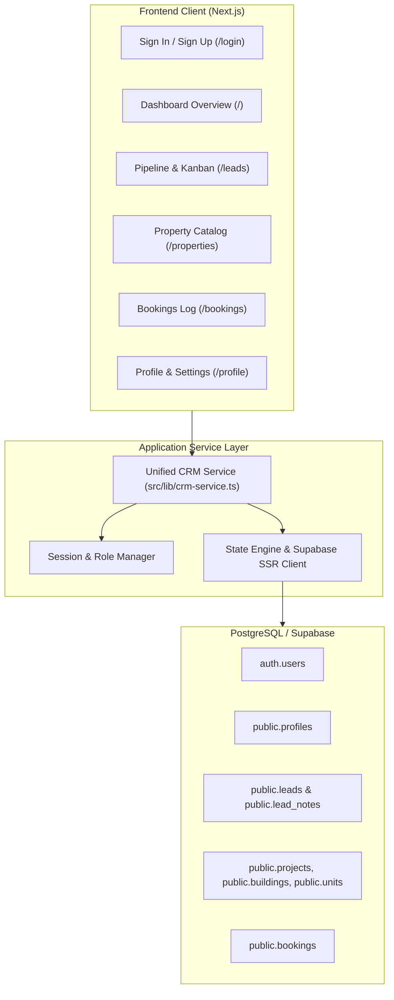

# NestCRM — Enterprise Real Estate CRM

> **“Close more. Manage less. Your deals, perfectly organized.”**

An enterprise Real Estate CRM engineered for sales teams to manage prospective buyers through a structured 7-stage pipeline, navigate hierarchical property inventories (**Developments → Towers → Units**), and execute conflict-free unit bookings with **Role-Based Access Control (Director vs. Sales Representative)**.

Built with **Next.js (App Router, Turbopack, TypeScript)**, **Tailwind CSS v4**, and **Supabase (PostgreSQL 15+)**.

---

## Repository
* **GitHub Repository:** [https://github.com/SyedZayan/real-estate-crm](https://github.com/SyedZayan/real-estate-crm)
* **Deployment Target:** [Vercel](https://vercel.com)

---

## Default Team Accounts

Share these credentials with your team for immediate evaluation and access:

| Role | Name | Email (Username) | Default Password |
| :--- | :--- | :--- | :--- |
| **Sales Director (Admin)** | Sarah Connor | `admin@realstate.com` | `nestcrm2026` |
| **Sales Representative** | John Doe | `john.doe@realstate.com` | `nestcrm2026` |
| **Sales Representative** | Rachel Green | `rachel.green@realstate.com` | `nestcrm2026` |

*New team members can also click **Sign Up** on `/login` to create their own accounts.*

---

## Key Highlights

- **Executive Aesthetic & Palette:** Custom professional color system (Executive Deep Navy `#091a2b`, Core Teal `#005163`, Slate Indigo `#3b4876`, Neutral Slate, and Crisp Off-White `#f4f6f8`).
- **Complete Authentication Flow:** Dedicated dual-tab **Sign-In** and **Sign-Up** screen supporting credential-based login, role creation, and one-click team selector.
- **Enforced Session Security:** In-app cross-user swapping is disabled. Consultants sign out from the bottom-left account menu before another team member can log in.
- **7-Stage Sales Pipeline:** Structured stages (`New` → `Contacted` → `Site Visit` → `Interested` → `Negotiation` → `Booked` → `Lost`) available in interactive **Kanban Board** and filterable **Table** views.
- **Multi-Tier Property Inventory:** Hierarchical cataloging from community projects down to towers, floor levels, specifications (1BHK, 2BHK, 3BHK, Penthouse), and real-time reservation locks.
- **Unit Reservation Flow:** One-click unit reservation with buyer linking, token collection tracking, and automated audit logging.

---

## Technology Stack

| Layer | Technologies | Purpose |
| :--- | :--- | :--- |
| **Frontend Framework** | **Next.js 16 (App Router, Turbopack)** | Server and Client hybrid architecture, high-performance compilation, modern routing. |
| **Language & Typing** | **TypeScript 5 & React 19** | Strict type safety across leads, units, bookings, and database responses. |
| **Styling & Tokens** | **Tailwind CSS v4 & Lucide Icons** | Professional color variables, responsive layouts, Poppins typography, dark/light modes. |
| **UI Primitives** | **Base UI & Sonner** | Accessible dialogs, dropdowns, and toast notifications. |
| **Database & Auth** | **Supabase (PostgreSQL 15+) & `@supabase/ssr`** | Relational data integrity, schema migrations, and authentication. |
| **Deployment** | **Vercel** | Edge-optimized deployment with zero configuration. |

---

## Architecture & Data Flow



---

## Role-Based Access Control (RBAC)

| Feature / Action | Sales Director (Admin) | Sales Representative (Agent) |
| :--- | :---: | :---: |
| **Login & Profile Management** | Full Access | Full Access |
| **Pipeline Visibility** | Company-wide (all agents) | Own assigned buyer deals |
| **Lead Creation** | Yes | Yes |
| **Lead Assignment** | Assign/reassign to any agent | Assigned by management |
| **Stage Progression** | All leads | Own assigned leads |
| **Notes & Follow-ups** | Yes | Yes |
| **Property Inventory** | Create projects, towers, & units | Read-only view of inventory & pricing |
| **Unit Booking** | Confirm reservations | Reserve units with customer token |
| **Sales Audit Log** | Company-wide totals | Personal closed deals |

---

## Getting Started

### 1. Clone the Repository
```bash
git clone https://github.com/SyedZayan/real-estate-crm.git
cd real-estate-crm
npm install
```

### 2. Configure Environment Variables
Create `.env.local` in the project root:
```env
NEXT_PUBLIC_SUPABASE_URL=https://your-project.supabase.co
NEXT_PUBLIC_SUPABASE_ANON_KEY=your-supabase-anon-key
```

### 3. Database Schema Setup (Supabase)
Run the migration scripts in `supabase/migrations/` in order inside the Supabase SQL editor:
1. `001_initial_schema.sql` (Tables, trigger, profiles, units, and leads)
2. `002_allow_anon_access.sql` (Public access policies for client evaluation)
3. `003_profiles_demo_access.sql` (Profile linking)
4. *(Optional)* `supabase/seed.sql` (Initial luxury projects, towers, and leads)

### 4. Run Locally
```bash
npm run dev
```
Open [http://localhost:3000](http://localhost:3000) in your browser.

---

## Deploy to Vercel

1. Push your repository to GitHub:
   ```bash
   git add .
   git commit -m "feat: initial commit of EstateFlow CRM"
   git branch -M main
   git remote add origin https://github.com/SyedZayan/real-estate-crm.git
   git push -u origin main
   ```
2. In [Vercel](https://vercel.com), select **"Add New Project"** → **Import Git Repository**.
3. Select `SyedZayan/real-estate-crm`.
4. Under **Environment Variables**, add:
   - `NEXT_PUBLIC_SUPABASE_URL`
   - `NEXT_PUBLIC_SUPABASE_ANON_KEY`
5. Click **"Deploy"**.

---

## License
MIT License. Developed for modern real estate sales teams.
